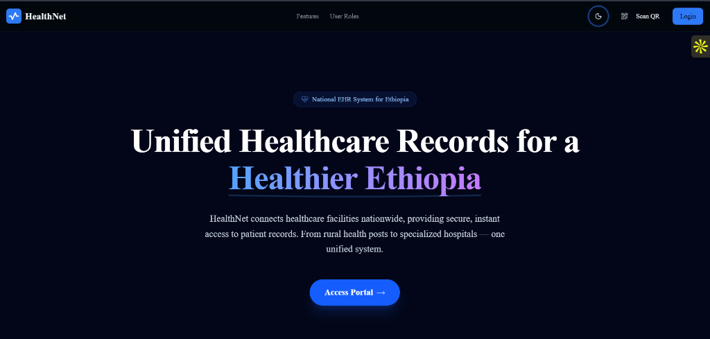
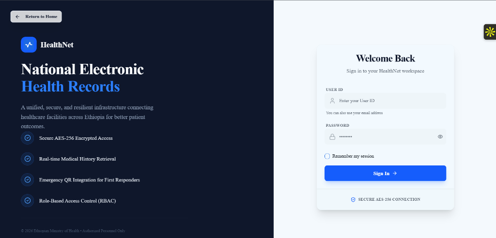
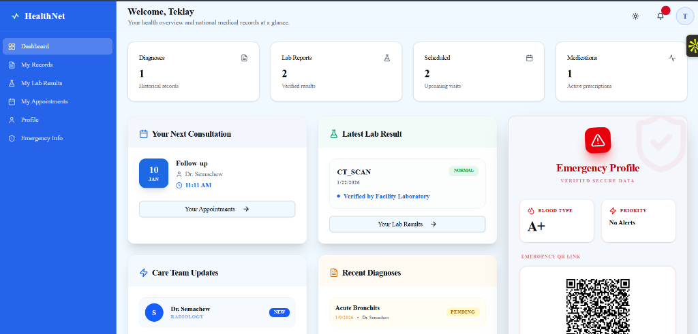
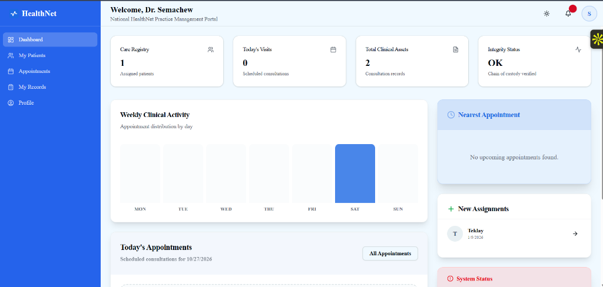
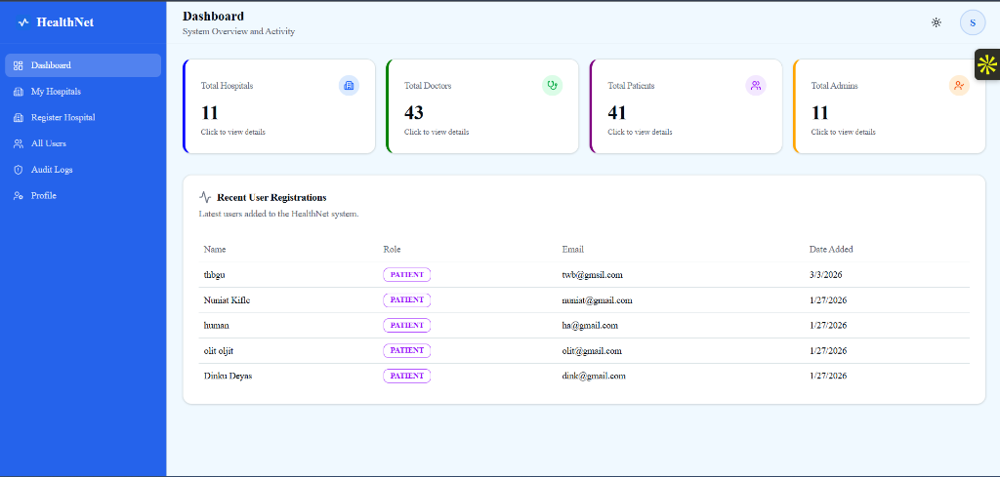

# HealthNet

Unified national electronic health records and healthcare management platform connecting facilities, medical personnel, and patients across Ethiopia.

Live Demo: https://health-net-ethiopia.vercel.app/

---

## Overview

HealthNet is a full-stack healthcare management system engineered with the PERN stack (PostgreSQL, Express, React, Node.js). The platform connects healthcare facilities across Ethiopia, providing secure, role-based access to patient medical histories, clinical diagnoses, laboratory reports, and emergency health passports.

---

## Screenshots

### 1. Landing Portal


### 2. Authentication Portal


### 3. Patient Dashboard and Emergency Profile


### 4. Doctor Clinical Practice Dashboard


### 5. Super Admin System Overview


---

## Features

- **Multi-Tenant Healthcare Facilities**: Centralized registry for hospitals and diagnostic laboratories with city, contact, and facility classification.
- **Role-Based Access Control (RBAC)**: Fine-grained permissions across four user roles: Super Admin, Hospital Admin, Doctor / Lab Technician, and Patient.
- **Doctor Practice Management**: Manage patient registries, schedule appointments, record clinical diagnoses with ICD-10 coding, and review patient medical histories.
- **Diagnostic Media and Lab Reports**: Laboratory result distribution with file attachments stored in Cloudinary and served through secure streaming proxy routes.
- **Patient Health Portal**: Personal health records dashboard displaying historical diagnoses, prescription notes, upcoming visits, and consultation schedules.
- **Emergency QR Health Pass**: Token-based QR code generation allowing first responders immediate access to vital blood type, known allergies, and emergency contact details.
- **Audit Logging and System Security**: Comprehensive audit trails recording user management actions, credential issuance, and administrative updates.

---

## Tech Stack

| Layer | Technology |
|---|---|
| Frontend Framework | React 19, Vite 7 |
| Frontend Styling | Tailwind CSS 4, Radix UI, Lucide Icons |
| Backend Framework | Node.js (>=20), Express 5 |
| Database & ORM | PostgreSQL (Neon Serverless), Prisma ORM 6 |
| Media Storage | Cloudinary |
| Authentication | JSON Web Tokens (JWT), bcryptjs |
| File Handling | Multer, Multer Storage Cloudinary |
| Utilities | QRCode, Day.js, jsPDF, Axios, Winston, Helmet, CORS |
| Deployment | Vercel (Frontend) |

---

## Demo Access

The application is deployed and live at:
https://health-net-ethiopia.vercel.app/

Demonstration accounts and role-based test credentials can be provided upon request.

---

## Project Structure

```text
HealthNet-V3/
├── backend/
│   ├── prisma/             # Database schema and seed scripts
│   ├── src/
│   │   ├── config/         # Database client configuration
│   │   ├── controllers/    # HTTP request controllers
│   │   ├── middleware/     # Authentication, upload, and error middleware
│   │   ├── routes/         # Express route definitions
│   │   ├── services/       # Core business logic services
│   │   ├── utils/          # Token, response, and ID generator utilities
│   │   ├── app.js          # Express app configuration
│   │   └── server.js       # Server bootstrap and listener
│   ├── .env.example        # Backend environment template
│   └── package.json
├── frontend/
│   ├── public/             # Static assets and icons
│   ├── src/
│   │   ├── components/     # UI components and layout widgets
│   │   ├── contexts/       # Auth and theme context providers
│   │   ├── layouts/        # Role layout wrappers
│   │   ├── pages/          # Application views by user role
│   │   ├── services/       # API client and endpoints
│   │   ├── App.jsx         # Application routing structure
│   │   └── main.jsx        # Frontend entry point
│   ├── .env.example        # Frontend environment template
│   └── package.json
├── docs/
│   └── screenshots/        # Interface preview images
└── README.md
```

---

## Getting Started

### Prerequisites

- Node.js (version 20 or higher)
- npm (version 9 or higher)
- PostgreSQL database instance (such as Neon PostgreSQL)
- Cloudinary account for diagnostic media storage

---

### Backend Setup

1. Navigate to the backend directory:
   ```bash
   cd backend
   ```

2. Install dependencies:
   ```bash
   npm install
   ```

3. Configure environment variables:
   ```bash
   cp .env.example .env
   ```
   Fill in the required values in `.env`:
   - `PORT`
   - `DATABASE_URL`
   - `JWT_SECRET`
   - `FRONTEND_URL`
   - `BACKEND_URL`
   - `CLOUDINARY_CLOUD_NAME`
   - `CLOUDINARY_API_KEY`
   - `CLOUDINARY_API_SECRET`
   - `COOKIE_SECURE`
   - `SUPERADMIN_PASSWORD`

4. Generate Prisma client and push schema to database:
   ```bash
   npm run build
   npx prisma db push
   ```

5. (Optional) Seed demo facilities and admin accounts:
   ```bash
   npm run seed
   ```

6. Start the development server:
   ```bash
   npm run dev
   ```

The backend runs by default on `http://localhost:5000`.

---

### Frontend Setup

1. Navigate to the frontend directory:
   ```bash
   cd frontend
   ```

2. Install dependencies:
   ```bash
   npm install
   ```

3. Configure environment variables:
   ```bash
   cp .env.example .env
   ```
   Set the API URL in `.env`:
   - `VITE_API_URL` (e.g., `http://localhost:5000`)

4. Start the development server:
   ```bash
   npm run dev
   ```

5. Build for production:
   ```bash
   npm run build
   ```

---

## Author

Developed by [effileo](https://github.com/effileo)
